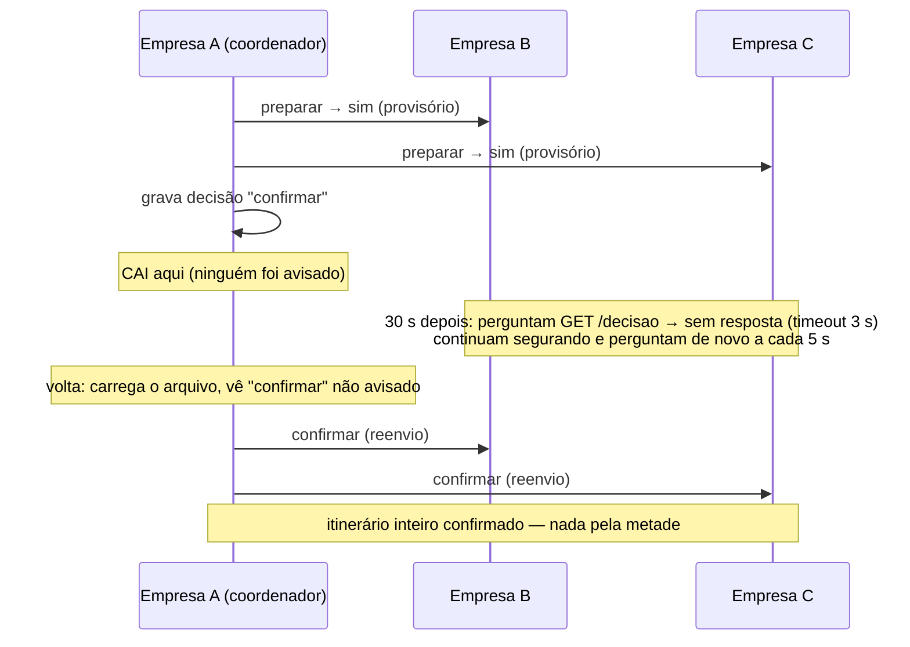

# Diagramas de sequência — confirmação de itinerário (2PC)

Itinerário da passageira Ana (empresa A): trecho da carona `B-1` (empresa B) + trecho da
carona `C-1` (empresa C). A empresa A coordena; B e C são as donas dos trechos.

## 1. Caminho feliz: todos dizem sim

```mermaid
sequenceDiagram
    participant P as Cliente (Ana)
    participant A as Empresa A<br/>(coordenador)
    participant B as Empresa B<br/>(dona de B-1)
    participant C as Empresa C<br/>(dona de C-1)

    P->>A: reservar [B-1, C-1] (TCP)
    A->>A: grava transação A-T7 = "perguntando"
    par fase 1 (ao mesmo tempo)
        A->>B: POST /transacoes/A-T7/preparar
        B->>B: trava; há assento? separa (provisório); grava
        B-->>A: 200 sim
    and
        A->>C: POST /transacoes/A-T7/preparar
        C->>C: trava; há assento? separa (provisório); grava
        C-->>A: 200 sim
    end
    A->>A: grava decisão "confirmar" (certidão antes do anúncio)
    par fase 2
        A->>B: POST /transacoes/A-T7/confirmar
        B->>B: provisório → confirmado; grava
        B-->>A: 200
    and
        A->>C: POST /transacoes/A-T7/confirmar
        C->>C: provisório → confirmado; grava
        C-->>A: 200
    end
    A-->>P: itinerário confirmado (A-T7)
```

## 2. Uma dona recusa: todos cancelam

```mermaid
sequenceDiagram
    participant A as Empresa A (coordenador)
    participant B as Empresa B
    participant C as Empresa C

    A->>A: grava A-T8 = "perguntando"
    A->>B: preparar
    B-->>A: 200 sim (provisório)
    A->>C: preparar
    C-->>A: 409 não (sem assento — ninguém espera)
    A->>A: grava decisão "cancelar"
    A->>B: cancelar
    B->>B: devolve o assento; grava
    A->>C: cancelar
    Note over A: responde ao cliente: reserva NÃO feita
```

## 3. Coordenador cai depois de gravar a decisão



## 4. Coordenador cai antes de decidir

```mermaid
sequenceDiagram
    participant A as Empresa A (coordenador)
    participant B as Empresa B

    A->>B: preparar → sim (provisório)
    Note over A: CAI antes de gravar a decisão
    Note over B: 30 s: pergunta GET /decisao → sem resposta; segura
    Note over A: volta: transação "perguntando" sem decisão → grava "cancelar"
    B->>A: GET /transacoes/A-T9/decisao
    A-->>B: cancelar
    B->>B: devolve o assento
    Note over B: se A nunca voltasse: após 5 min B libera sozinho (válvula)
```
